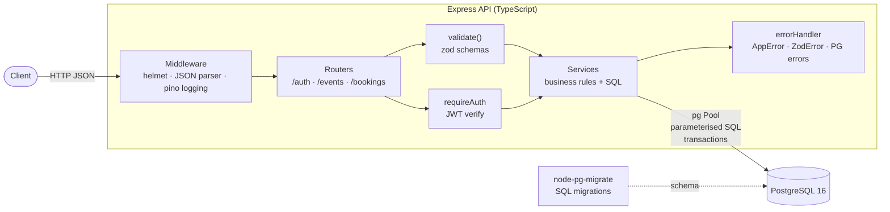
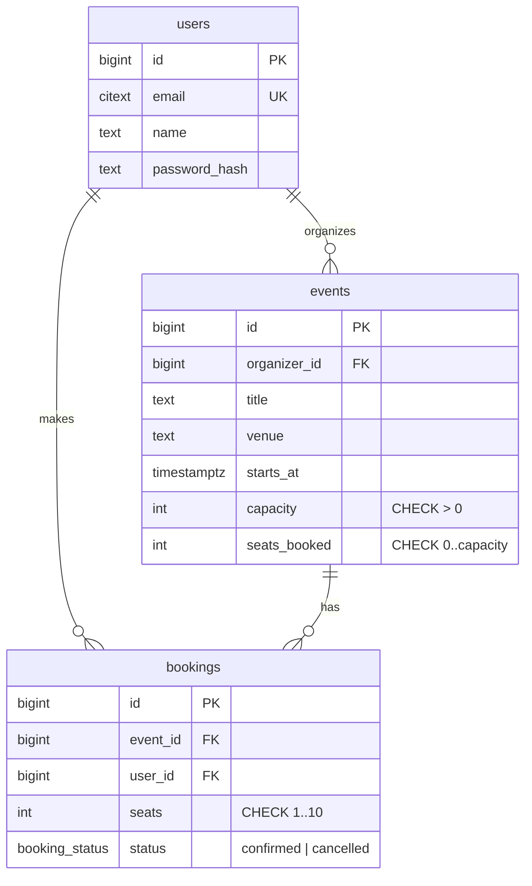
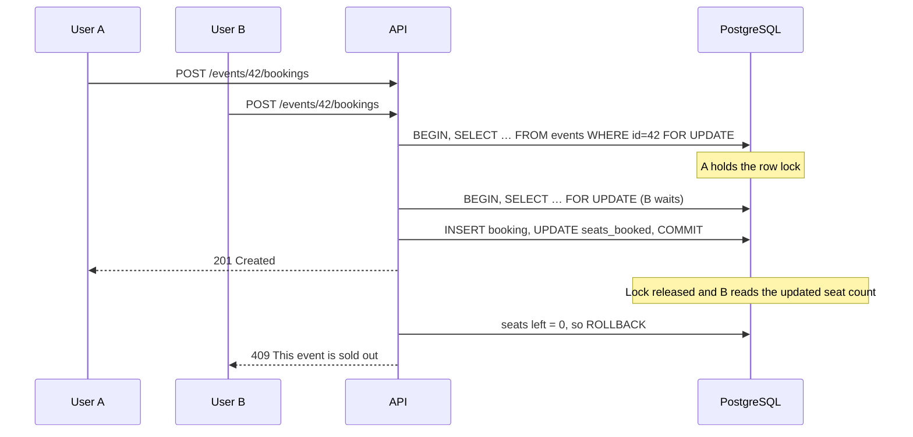

# Event Booking API

[](https://github.com/code-with-sen/event-booking-api/actions/workflows/ci.yml)


[](https://event-booking-api-l53d.onrender.com)

A REST API for creating events and booking seats, built with **TypeScript, Express and PostgreSQL**.

The core problem it solves: when many people try to book the last few seats at the same moment, **the event must never be overbooked**. Bookings run inside a Postgres transaction with a row lock, and a `CHECK` constraint backs it up at the database level. A test fires 20 concurrent requests at an event with 5 seats and asserts that exactly 5 succeed.

## Live demo

**Base URL:** https://event-booking-api-l53d.onrender.com

| Try it | URL |
|---|---|
| API overview | [/](https://event-booking-api-l53d.onrender.com/) |
| Health check (API + database) | [/health](https://event-booking-api-l53d.onrender.com/health) |
| Upcoming events | [/api/v1/events](https://event-booking-api-l53d.onrender.com/api/v1/events) |

> Hosted on Render's free tier, so the first request after 15 minutes of inactivity can take up to a minute while the server wakes up. The database is a free Neon Postgres instance.

The [example requests](#example) below run against the live demo by default, so you can register, create events and book seats right away.

## Features

- **Auth**: register / login with bcrypt-hashed passwords and JWT bearer tokens
- **Events**: create, list (pagination + search), update, delete. Only the organizer can modify an event
- **Bookings**: book 1–10 seats, cancel, list my bookings; organizers can see their attendee list
- **Concurrency-safe booking** with `SELECT … FOR UPDATE` + database constraints
- **Input validation** on every request with zod, returning field-level errors
- **SQL migrations** with node-pg-migrate (up and down)
- **Consistent error format** and mapping of Postgres constraint errors to `409 Conflict`
- **25 integration tests** (Jest + Supertest) against a real Postgres, ~96% statement coverage
- **CI** on every push (typecheck → build → migrate → test → Docker build)
- **Docker**: multi-stage image and docker-compose for one-command local setup

## Architecture



Each feature lives in its own module (`src/modules/<feature>`) with three files:

| File | Responsibility |
|---|---|
| `*.schemas.ts` | zod schemas for body / query / params, and the inferred TypeScript types |
| `*.service.ts` | business rules and SQL; throws typed `AppError`s |
| `*.routes.ts` | thin HTTP layer: wires auth + validation to a service call |

### Data model



Key constraints:

- `seats_within_capacity`: `CHECK (seats_booked BETWEEN 0 AND capacity)`
- `bookings_one_active_per_user_event`: a **partial unique index** on `(event_id, user_id) WHERE status = 'confirmed'`, so a user can rebook after cancelling but can't hold two active bookings
- `email` is `CITEXT`, so `A@x.com` and `a@x.com` are the same account

### How a booking avoids overbooking



The lock only covers **one event row**, so bookings for different events never wait on each other.

## API

Base path: `/api/v1`. Send `Authorization: Bearer <token>` for routes marked 🔒.

| Method | Path | Description |
|---|---|---|
| `GET` | `/health` | Liveness + database check |
| `POST` | `/auth/register` | Create an account → `{ user, token }` |
| `POST` | `/auth/login` | Log in → `{ user, token }` |
| `GET` | `/auth/me` 🔒 | Current user |
| `GET` | `/events?limit=&offset=&q=&includePast=` | List upcoming events |
| `GET` | `/events/:id` | Event details with `seatsAvailable` |
| `POST` | `/events` 🔒 | Create an event (you become the organizer) |
| `PATCH` | `/events/:id` 🔒 | Update an event (organizer only) |
| `DELETE` | `/events/:id` 🔒 | Delete an event (organizer only) |
| `GET` | `/events/:id/bookings` 🔒 | Attendee list (organizer only) |
| `POST` | `/events/:id/bookings` 🔒 | Book seats: `{ "seats": 2 }` |
| `GET` | `/bookings/me` 🔒 | My bookings |
| `POST` | `/bookings/:id/cancel` 🔒 | Cancel my booking |

### Error format

Every error uses the same shape:

```json
{
  "error": {
    "code": "VALIDATION_ERROR",
    "message": "Request validation failed",
    "details": [{ "path": "body.capacity", "message": "Number must be greater than or equal to 1" }]
  }
}
```

| Status | When |
|---|---|
| `400` | Validation failed or malformed JSON |
| `401` | Missing / invalid token, wrong credentials |
| `403` | Not the organizer of the event |
| `404` | Resource not found (also used for other users' bookings, so IDs can't be probed) |
| `409` | Sold out, duplicate booking, duplicate email, capacity below seats booked |
| `422` | Event has already started |

### Example

```bash
BASE=https://event-booking-api-l53d.onrender.com   # or http://localhost:3000

# Register and grab the token
TOKEN=$(curl -s -X POST $BASE/api/v1/auth/register \
  -H 'Content-Type: application/json' \
  -d '{"email":"me@example.com","name":"Me","password":"password123"}' | jq -r .token)

# Create an event
curl -s -X POST $BASE/api/v1/events \
  -H "Authorization: Bearer $TOKEN" -H 'Content-Type: application/json' \
  -d '{"title":"TypeScript Meetup","venue":"Bengaluru","startsAt":"2027-01-15T18:00:00Z","capacity":50}'

# Book 2 seats
curl -s -X POST $BASE/api/v1/events/1/bookings \
  -H "Authorization: Bearer $TOKEN" -H 'Content-Type: application/json' -d '{"seats":2}'
```

## Getting started

### With Docker (quickest)

```bash
docker compose up --build
# API on http://localhost:3000, migrations run automatically on start
```

### Locally

Requires Node.js 20+ and PostgreSQL 14+.

```bash
npm install
cp .env.example .env          # set DATABASE_URL and JWT_SECRET
createdb event_booking
npm run migrate:up
npm run dev                   # http://localhost:3000
```

### Running tests

The tests run against a real Postgres database (`event_booking_test` by default) and migrate it automatically.

```bash
createdb event_booking_test
npm test                      # or: npm test -- --coverage
```

## Deployment

The live demo runs as a free Docker web service on [Render](https://render.com), defined in [`render.yaml`](render.yaml), with a free [Neon](https://neon.com) Postgres database.

1. Create a Neon project and copy its **direct** (non-pooled) connection string.
2. In Render, create a **Blueprint** from this repo and paste the string as `DATABASE_URL`. Render generates `JWT_SECRET` automatically.
3. On every start, the container applies pending migrations and then launches the API.

## Scripts

| Script | What it does |
|---|---|
| `npm run dev` | Start with hot reload (tsx) |
| `npm run build` / `npm start` | Compile to `dist/` and run |
| `npm run typecheck` | `tsc --noEmit` |
| `npm test` | Jest integration tests |
| `npm run migrate:up` / `migrate:down` | Apply / roll back migrations |
| `npm run migrate:create <name>` | New SQL migration |

## Design decisions

- **Raw SQL with `pg` instead of an ORM**: the booking logic depends on exact SQL (`FOR UPDATE`, partial indexes, `CHECK` constraints), and an ORM would hide it.
- **Pessimistic locking over optimistic retries**: booking contention is concentrated on a single hot row (a popular event), so a short row lock is simpler and more predictable than retry loops.
- **Defence in depth**: the application checks seats under a lock, and the database constraint guarantees the invariant even if a future code path forgets to.
- **A `seats_booked` counter** instead of `SUM(seats)` on every read keeps event listing cheap; it's only ever changed in the same transaction as a booking.
- **Integration tests over mocks**: most of the risk is in SQL and transactions, so tests hit a real Postgres, in CI too.

## Project structure

```
src/
  app.ts                 Express app factory (used by server and tests)
  server.ts              HTTP server + graceful shutdown
  config/                zod-validated env, pino logger
  db/pool.ts             pg Pool + withTransaction helper
  middleware/            auth, validate, error handler
  modules/
    auth/                register, login, me
    events/              events CRUD + attendee list
    bookings/            booking + cancellation
migrations/              SQL migrations
tests/                   Jest + Supertest integration tests
```

## License

MIT © Animesh Sen
